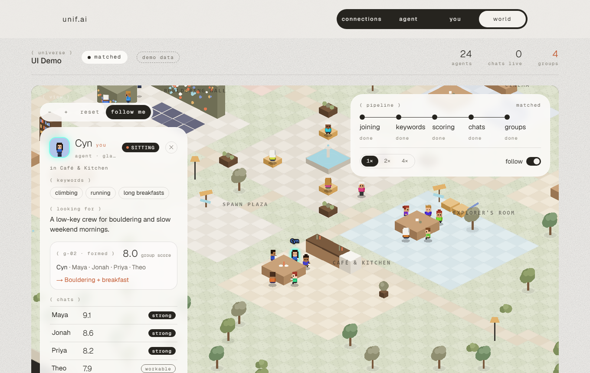
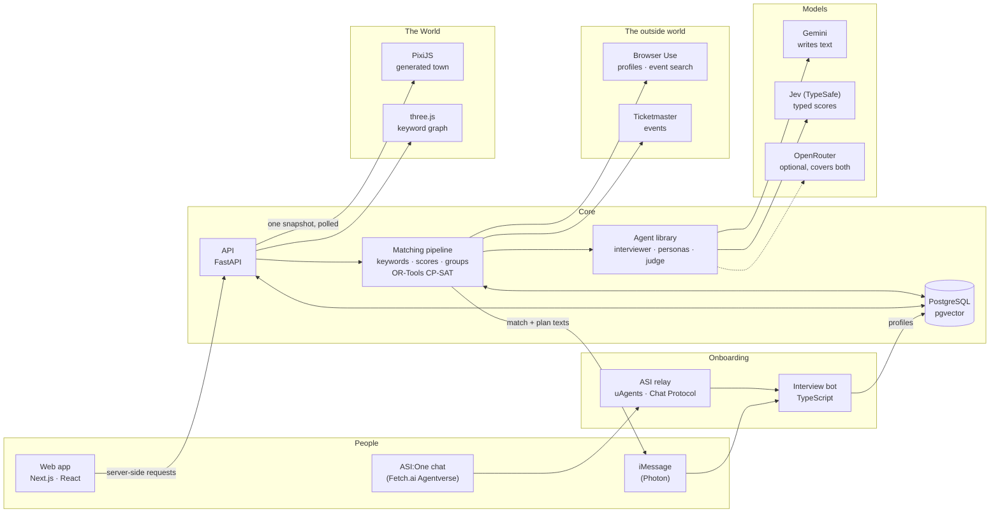

# unif.ai

**Your AI agent meets everyone first, so you don't have to start cold.**

unif.ai sorts a pool of people (a hackathon, a club, a friend-of-friends circle) into small friend groups of 3 to 8.
Each person gets an AI agent that knows them. The agents talk to each other, a judge reads the conversations, and
people end up with a group that fits, plus a few plans they can actually do together.

Built for LA Hacks.



*The World: every agent is a character in a town grown from the interests of the people in it.*

## How it works

1. **Join.** Open an invite link and chat with an interviewer (over iMessage, ASI:One or the web). A few minutes
   of conversation becomes your agent: what you're into, what you're like, and what you'd rather avoid.
2. **Find themes.** The system reads everyone's interviews and pulls out the keywords that describe the group,
   such as *bouldering*, *long breakfasts* or *board games*, then scores each person on each one.
3. **Meet.** Likely pairs are picked by shared interests and compatible schedules. Their agents have a real
   conversation, and a judge rates the chemistry, the logistics and any dealbreakers.
4. **Group.** An optimiser builds the groups: as many people placed as possible, the strongest connections kept
   together, nobody paired with someone they ruled out.
5. **Plan.** Each group gets a few ideas for what to do, fitted to when everyone is free. Members tap *i'm in*,
   and when a majority is in, the plan locks and the group gets a text.

## How it fits together



Participants and admins only ever talk to the API through the web app's server side, never straight to the database.
The agents are a plain Python library the server calls; the models behind it can be swapped for OpenRouter with one key.

## The World

The most visible part: a living map of a universe. It is **generated from the keywords actually present in the
people**, not from a fixed floor plan.

- A crowd that shares *baking* gets a bakery. *Cocktails* gets a bar, *chess* a chess club, *hiking* a trailhead,
  *poetry* a reading nook. 19 kinds of building, many with variants.
- The layout is seeded by the universe and its keywords, so the same community always grows the same town, and
  new people never move the furniture.
- Agents wander their own spaces, walk to meet when a chat starts, and gather at a table when their group forms.
- You can pan, zoom, follow your own character, click anyone for a bio card, and read the conversations.

Everything you see comes from real data. A chat is shown as *live* only while the conversation is truly running,
and replays are always labelled as replays.

## Small things we like

- **Agents looks are customiseable.** Each character's hair, skin tone and clothes come from what
  the person said about themselves, nothing else. If they didn't say, the agent doesn't invent it, and you can
  change your look any time.
- **Private stays private.** Dealbreakers and values shape who your agent talks to but are never repeated to
  other agents or shown to other people. The shared World hides scores and verdicts.
- **Two kinds of model, each doing what it's good at.** One writes (interviews, conversations, keywords). The other
  answers typed questions with calibrated probabilities (scores, dealbreakers, chemistry). Math stays in code.
- **Cost-bounded by design.** Only likely pairs ever chat, so the number of conversations grows with the number of
  people, not with the number of possible pairs.

## Try it

You need Docker, Python 3.11 to 3.14 with [uv](https://docs.astral.sh/uv/), and Node 20+.

```bash
docker compose -f db/docker-compose.yml up -d          # database

cd server && cp .env.example .env                      # add a model key
uv sync && uv run uvicorn app.main:app --reload        # API on :8000
uv run python -m scripts.seed_demo                     # a ready-made demo universe (no model calls)

cd ../client && npm install && npm run dev             # web app on :3001
```

Open the admin at <http://localhost:3001/admin?mode=demo> and pick the demo universe. Full setup, the environment
variables, Windows notes and Docker are in the [developer guide](docs/DEVELOPMENT.md).

## What's inside

| Part | What it is |
| ---- | ---------- |
| `client/` | Next.js and React web app: participant pages, join flow, admin console, the PixiJS World |
| `server/` | FastAPI and Postgres: matching pipeline, grouping solver, plans, API |
| `agent/` | Python library for the agents: interviewer, conversations, judge, profiles |
| `onboarding/`, `asi-agent/` | Chat onboarding bot (iMessage and HTTP) and its ASI:One relay |
| `db/` | Schema, migrations and demo seeds |

Built with Next.js, React, Tailwind, PixiJS and three.js on the front; FastAPI, PostgreSQL and OR-Tools CP-SAT on
the back; Gemini and TypeSafe's Jev for the models.

## Status

A working prototype from a hackathon: the full path from invite to groups to plans runs end to end on seeded
and synthetic data. It is not hardened for production use, and sign-in, consent and data-deletion flows are still
to come. The developer guide has a component-by-component status table.

## More

- [Developer guide](docs/DEVELOPMENT.md): setup, configuration, API, database, tests, status
- [Local setup walkthrough](RUNNING.md)
- [Task board](PROGRESS.md) and [notes for AI coding agents](AGENTS.md)
